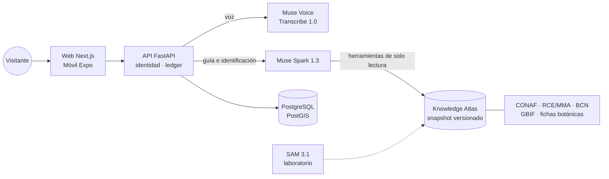

<p align="center">
  
</p>

<h1 align="center">Bosque Vivo Chile</h1>

<p align="center"><b>Explore Chile's national parks with grounded, multimodal Meta AI</b></p>

<p align="center">
  <a href="https://github.com/GiuseppePrbst/meta-global-ai-dev-hackathon-progarlabs/actions/workflows/ci.yml"></a>
  
  
  
  
</p>

Built during the **Meta Global AI Developer Hackathon 2026** by [ProGarLabs](https://progarlabs.com/), a technology startup from southern Chile. Startup Track, theme Build for Your World.

> Explore nature with AI that knows what it knows, and what it cannot verify.

**[Try the live API](https://api-bosquevivo.progarlabs.com/docs)** · **[Live status](https://api-bosquevivo.progarlabs.com/demo/status)** · **[Judge quickstart](docs/submission/JUDGE_QUICKSTART.md)** · **[Technical evidence](docs/submission/SUBMISSION_EVIDENCE.md)** · **[Versión en español](#por-qué-existe)**

**Demo video:** linked in our hackathon submission; script in [docs/submission/VIDEO_SCRIPT_FINAL.md](docs/submission/VIDEO_SCRIPT_FINAL.md).

## Try it

No account or key. The public API uses real Meta models until 2026-11-10T05:00:00Z, for adults in permitted territories.

```bash
curl -s https://api-bosquevivo.progarlabs.com/guide/query -H "Content-Type: application/json" -d '{"question":"What trails are in Puyehue National Park? Are they open today?","adult_confirmed":true,"external_processing_confirmed":true}'
```

Examples for voice, photos and WebSocket are in [docs/PUBLIC_DEMO.md](docs/PUBLIC_DEMO.md). `/docs` is a technical API surface, not a consumer app.

## What we built during the hackathon

From 26-10-2026 to 04-11-2026 ([full record](docs/HACKATHON_CONTRIBUTIONS.md)):

- **Knowledge Atlas:** 46 national parks, 190 reviewed trails and 20 sourced taxa, as a versioned snapshot ([#32](https://github.com/GiuseppePrbst/meta-global-ai-dev-hackathon-progarlabs/pull/32)).
- **Wilo:** grounded conversation with restricted tools, plus real voice input ([#33](https://github.com/GiuseppePrbst/meta-global-ai-dev-hackathon-progarlabs/pull/33)).
- **Identification:** photo suggestions with verification and abstention ([report](docs/OPEN_SET_IDENTIFICATION_REPORT.md)).
- **Public API:** deployed behind Cloudflare with PostGIS, a spending ledger, consent, territory limits and a hard expiry ([#50](https://github.com/GiuseppePrbst/meta-global-ai-dev-hackathon-progarlabs/pull/50)).

Meta's models, public datasets and open-source frameworks are pre-existing. ProGarLabs' business background is context, not hackathon work.

## Meta models

| Model | Role | Status |
| --- | --- | --- |
| Muse Spark 1.3 | Wilo's grounded answers with Atlas tools; photo comparison, verification and abstention | Deployed |
| Muse Voice Transcribe 1.0 | Spanish, English and mixed voice input, with park and scientific name keywords | Deployed |
| SAM 3.1 | Image and video segmentation research. It does not identify species | Experimental, outside the product |

## Three core capabilities

1. **Grounded conversation:** Wilo answers from the Atlas, shows sources and says what isn't verified, such as trail openings.
2. **Photo suggestions:** a result is always a suggestion, even with `acceptance=accepted`. Outside the catalog, the system abstains.
3. **Conservation-aware knowledge:** sensitive species keep evidence at park scale, with no coordinates of individuals.

## Verifiable results

| Area | Result | Note |
| --- | --- | --- |
| Atlas | 46 parks, 190 reviewed trails | 0 licensed trail geometries |
| Voice | 79 real recordings, WER about 0.10 | One speaker |
| Wilo end to end | 16 of 18 scenarios semantically correct | Answers about 20–37 s |
| Identification | Wrongly accepted negatives: 25/37 to 3/37 | 56 fixed cases, weak labels. Not certified accuracy |
| SAM 3.1 | Median mask IoU 0.79–0.83 | References made by the agent, not specialists |

**Known error:** on the public route, a photo labelled *Nothofagus dombeyi* was accepted as *N. betuloides*.

## Real, prototype or future

| Status | What |
| --- | --- |
| Real and deployed | Public API, Atlas, Wilo text and voice, identification, ledger and controls |
| Implemented, not the path shown | Official web app; Facebook Login code, with no provider configured |
| Mobile app | Prototype. Client code for the API, Wilo, identification and consent is merged (#56), but calls are simulated by default (`EXPO_PUBLIC_WILO_LIVE=false`, `EXPO_PUBLIC_IDENTIFY_LIVE=false`). No build has been verified against the public API |
| Experimental | SAM 3.1 research; Wilo Lab test client |
| Future work | Licensed trail geometry, specialist review, user validation |

## Architecture

User → interface → Cloudflare → FastAPI → Meta Model API, with knowledge tools and PostGIS → answer. Clients never receive a Meta key.

## Team, licenses and next steps

José Schwerter (frontend, UI/UX) and Giuseppe Proboste (GIS, ML, backend, integration), ProGarLabs SpA, Osorno, Chile. No code license has been defined yet, so a public repository doesn't mean open source. Not affiliated with CONAF. No users, partners or impact results yet.

Installation is in [Quick start](#quick-start). Sources and licenses are in [Datos, licencias y fuentes](#datos-licencias-y-fuentes).

---

## Versión en español

Bosque Vivo Chile transforma la exploración de los parques nacionales en una experiencia interactiva que conecta inteligencia artificial, biodiversidad, cartografía y aprendizaje ambiental. Lo desarrolla [ProGarLabs](https://progarlabs.com/), de Osorno, Chile, para la **Meta Global AI Developer Hackathon 2026**.

> **In English.** Bosque Vivo is a bilingual nature companion for Chile's national parks. You ask **Wilo**, our guide, a question by voice. Muse Voice Transcribe hears it, and Muse Spark answers from a versioned atlas of 46 official CONAF parks, their trails and a sourced biodiversity catalog. Every claim cites its source, and Wilo abstains when the evidence isn't there. SAM 3.1 adds visual segmentation research for species exploration.

---

## Por qué existe

La información sobre la naturaleza chilena está repartida entre fichas oficiales, nóminas de conservación, guías turísticas y bases científicas. Cada fuente tiene su propio formato y su propio nivel de confianza.

Para quien visita un parque, eso se traduce en preguntas sin respuesta clara: qué senderos están documentados, qué especie está mirando, si un dato es oficial. Y las apps que «identifican todo» con una foto suelen responder con una seguridad que no tienen.

**Bosque Vivo responde distinto.** Reúne la información verificable de cada parque y la explica en lenguaje cercano. Además, dice con claridad qué sabe, de dónde lo sabe y qué no puede afirmar: «este sendero no tiene apertura verificada», «el color no basta para identificar este hongo».

## Capacidades

| | Capacidad | Estado en `main` |
| --- | --- | --- |
| 🦦 | **Wilo**: guía bilingüe por voz o texto, con fuentes citadas, fichas y mapas | Validado con 79 grabaciones reales y 18 escenarios con audio real |
| 🗺️ | **Atlas**: 46 parques nacionales de CONAF, con senderos, sectores, avisos de visita y encuadres de mapa | Implementado y probado |
| 🌲 | **Exploración desde Puyehue**: piloto con expedición de referencia, capturas y colección privadas | Implementado. Las capturas están probadas con PostGIS |
| 🔍 | **Identificación**: Muse Spark verifica entre ocho especies de árboles y se abstiene si no está seguro | Validada en un conjunto de prueba fijo; no es precisión certificada |
| ✂️ | **Segmentación**: SAM 3.1 selecciona y sigue organismos en imagen y video | Investigación experimental, fuera del producto |
| 🍄 | **Biodiversidad**: 20 taxones de flora, fauna y hongos, con fuentes y fotos con licencia | Implementado, con criterios de elegibilidad para la demo |
| 🛡️ | **Conservación**: categorías RCE por región y protección de especies sensibles | Implementado. Wilo nunca entrega ubicaciones de fauna sensible |

El estado de cada funcionalidad, con su evidencia, está en **[docs/PROJECT_DELIVERY_STATUS.md](docs/PROJECT_DELIVERY_STATUS.md)**.

## Así responde Wilo

Esta es una respuesta real, generada el 03-11-2026 a partir de audio real. Aquí aparece abreviada; la versión completa está en [docs/api/examples/observed](docs/api/examples/observed/wilo-answer-34-mixed.json).

```text
🎙  «Hey Wilo, ¿qué senderos hay en Puyehue National Park? Please answer in English.»

🦦  In Puyehue National Park CONAF names three trails: El Indio, La Princesa and
    Repucura. I don't have live verification of opening status, distances or
    conditions, so please check the current CONAF notice before your visit.

    fuentes   atlas:puyehue-el-indio · atlas:puyehue-la-princesa · atlas:puyehue-repucura (CONAF)
    entidades park:puyehue · trail:puyehue-el-indio · …
    mapa      park_id=puyehue · geometry_available=false
```

## Arquitectura



Cada capa cumple un papel distinto:

- **Inferencia:** los modelos de Meta, llamados solo desde el backend.
- **Conocimiento:** un snapshot local del Atlas, sin red. No entrena ningún modelo.
- **Persistencia:** PostgreSQL con PostGIS.
- **Geoespacial:** encuadres de mapa y contexto forestal.
- **Interfaz:** web y móvil.

Las fronteras de privacidad y el mapa completo están en [docs/PROJECT_INTEGRATION_MAP.md](docs/PROJECT_INTEGRATION_MAP.md).

## Tecnologías

| Capa | Stack |
| --- | --- |
| Interfaz | Next.js, TypeScript, Tailwind, MapLibre · Expo / React Native |
| Backend | Python 3.12, FastAPI, Pydantic · PostgreSQL / PostGIS |
| IA de Meta | Muse Spark 1.3 · Muse Voice Transcribe 1.0 · SAM 3.1 |
| Datos | CONAF, RCE/MMA, BCN SNASPE, GBIF/COL, CHMv2 |
| Calidad | Ruff, Pytest, Vitest, Playwright, Gitleaks, GitHub Actions |

## Resultados

Son resultados experimentales sobre los conjuntos indicados; no certifican exactitud general.

| Área | Resultado | Nota metodológica |
| --- | --- | --- |
| Atlas | **46/46** parques del índice de CONAF · **190** senderos de fichas oficiales revisadas | 199 registros en total, incluidos 3 nombrados y 6 de una guía turística · **0** trazados con licencia |
| Biodiversidad | **20** taxones · **13** listos para la demo · 5 educativos · 2 excluidos | Revisión hecha por el agente, no por un especialista |
| Voz (Wilo) | **79** grabaciones reales · 71 alineadas al guion · **WER ≈ 0,10** (ES 0,100, EN 0,105) · 9/9 nombres científicos | Un solo hablante. Sin las palabras clave del Atlas, «Wilo» falla 11 de 11 veces |
| Wilo de punta a punta | **16 de 18** escenarios con audio real correctos en lo semántico | La respuesta tarda 20–37 s · [escenarios](docs/WILO_DEMO_SCENARIOS.md) |
| Identificación | Negativos aceptados: de **25/37 a 3/37** con la estrategia `verify` | 56 casos fijos con etiquetas débiles |
| SAM 3.1 | IoU mediano de máscara **0,79–0,83** · seguimiento en 9 de 9 frames, con IoU 0,89 | Referencias hechas por el agente, no validadas por especialistas |

Las métricas con audio sintético se reportan por separado en [docs/WILO_ASR_REAL_EVALUATION.md](docs/WILO_ASR_REAL_EVALUATION.md).

## Quick start

Requisitos: Node.js 24 y npm 10 o superior, Python 3.12 y [uv](https://docs.astral.sh/uv/). Docker es opcional y sirve para PostGIS. **El modo mock no necesita claves.**

```bash
git clone https://github.com/GiuseppePrbst/meta-global-ai-dev-hackathon-progarlabs.git
```

```bash
cd meta-global-ai-dev-hackathon-progarlabs && cp .env.example .env
```

```bash
npm ci && uv sync --project services/api --extra dev --frozen
```

```bash
uv run --project services/api --extra dev --frozen uvicorn bosque_api.main:app --reload --port 8000
```

```bash
npm run dev
```

Con todo en marcha:

| Qué | Dónde |
| --- | --- |
| Web | <http://localhost:3000> |
| OpenAPI | [localhost:8000/docs](http://localhost:8000/docs) |
| Health | [localhost:8000/health](http://localhost:8000/health) |
| Parques | [localhost:8000/parks](http://localhost:8000/parks) |

Para el stack completo con PostGIS, `docker compose up --build`. El modo Meta real, el ledger y los tokens de demo se configuran según [docs/DEPLOYMENT.md](docs/DEPLOYMENT.md).

## API y contratos

- **[docs/FRONTEND_HANDOFF.md](docs/FRONTEND_HANDOFF.md)**: punto de entrada para el frontend, con endpoints, estados de la UI, mapas y la demo.
- **[docs/WILO_VOICE_API_HANDOFF.md](docs/WILO_VOICE_API_HANDOFF.md)**: voz, `/guide/ask` y el protocolo WebSocket.
- **[docs/api/openapi.json](docs/api/openapi.json)**: el OpenAPI que genera FastAPI, verificado en CI, más [ejemplos validados](docs/api/examples).
- **[docs/PROJECT_INTEGRATION_MAP.md](docs/PROJECT_INTEGRATION_MAP.md)**: cómo se conectan los componentes.

## Demo y limitaciones

- **Alcance:** el piloto es el Parque Nacional Puyehue. El índice nacional cubre lo que publican las fichas de CONAF, no todos los senderos de Chile.
- **Respuestas:** Wilo responde solo con datos del Atlas y se abstiene cuando no tiene evidencia.
- **Mapas:** no hay trazados de senderos ni navegación, solo encuadres de referencia y enlaces oficiales.
- **Apertura de senderos:** no se verifica en tiempo real. Que no esté verificada no significa que esté abierto.
- **Hongos:** las fichas son educativas. No hay identificación fiable entre especies de *Cyttaria* ni consejos de consumo.
- **SAM:** segmenta organismos, pero no certifica la especie.
- **Despliegue:** API pública en Cloud Run detrás de Cloudflare, con Meta real hasta 2026-11-10T05:00:00Z ([PUBLIC_DEMO](docs/PUBLIC_DEMO.md)). El frontend oficial aún no está publicado.
- **Contenido científico:** depende de sus fuentes y aún no lo ha revisado un especialista.

El estado final de la entrega está en [docs/submission/JUDGE_QUICKSTART.md](docs/submission/JUDGE_QUICKSTART.md).

## Equipo

| Persona | Responsabilidad en el proyecto |
| --- | --- |
| José Schwerter | Frontend y UI/UX |
| Giuseppe Proboste | GIS, ML e integración tecnológica |
| Fabiana García | Diseño de producto; cofundadora de ProGarLabs |

Estos roles describen el proyecto, no la participación formal en el evento. La admisión de Fabiana a la competencia **no está confirmada**, así que no se le atribuyen aportes a la entrega sin autorización de los organizadores ([gobernanza](docs/TEAM_AND_GOVERNANCE.md)). El uso de asistencia de IA está declarado en [docs/HACKATHON_CONTRIBUTIONS.md](docs/HACKATHON_CONTRIBUTIONS.md).

## Datos, licencias y fuentes

- **Trazabilidad:** cada dato conserva su fuente, su fecha y sus derechos ([SOURCES](docs/SOURCES.md) · [DATASET_LICENSES](docs/DATASET_LICENSES.md) · [DATA_GOVERNANCE](docs/DATA_GOVERNANCE.md)).
- **Material restringido:** los medios de Hepta Insights y sus derivados son **RESTRICTED** y no están en el repositorio. Tampoco lo están las grabaciones de voz ni las salidas privadas del laboratorio.
- **Licencias:** que el repositorio sea público no lo convierte en licencia abierta. ProGarLabs aún no ha definido una licencia de código, y cada dataset y medio conserva sus propios términos.

## Enlaces

- [Repositorio](https://github.com/GiuseppePrbst/meta-global-ai-dev-hackathon-progarlabs) · [ProGarLabs](https://progarlabs.com/)
- Reportes:
  - [Wilo: evaluación de voz](docs/WILO_ASR_REAL_EVALUATION.md)
  - [Knowledge Atlas](docs/WILO_KNOWLEDGE_ARCHITECTURE.md)
  - [SAM 3.1](docs/SAM31_EXTENDED_RESEARCH_REPORT.md)
  - [Identificación de conjunto abierto](docs/OPEN_SET_IDENTIFICATION_REPORT.md)
  - [Auditoría de biodiversidad](docs/WILO_BIODIVERSITY_DEMO_AUDIT.md)
- Carpetas del repositorio:
  - `apps/web` y `apps/mobile`
  - `services/api`, `services/botanical-ai` y `services/geospatial`
  - `data/public`, `evaluations`, `tools` y `docs`

  Ver [ARCHITECTURE](docs/ARCHITECTURE.md) y [CONTRIBUTING](CONTRIBUTING.md).
