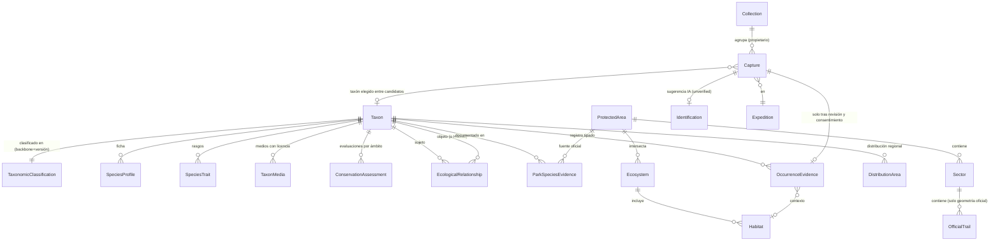

# Modelo de datos del gemelo digital

Arquitectura **conceptual** del 31-10-2026. No hay migraciones ni endpoints nuevos en este
cambio. Los IDs existentes (`species.id` como `nothofagus-dombeyi`, `observation_id`,
`capture_id`, `identification_id`, `expedition_id`) se conservan: las entidades nuevas los
referencian y no los reemplazan. Definición de producto en
[PRODUCT_VISION_ECOSYSTEM.md](PRODUCT_VISION_ECOSYSTEM.md).

## Entidades

| Grupo | Entidad | Propósito | Existe hoy |
| --- | --- | --- | --- |
| Biodiversidad | `Taxon` | Unidad taxonómica estable con ID interno | Parcial: `Species` para 8 árboles |
| | `TaxonomicClassification` | Reino, phylum, clase, orden, familia y género, con backbone y versión (GBIF, COL XR, WFO, MycoBank) | Parcial: `taxonomy` en `Species` |
| | `SpeciesProfile` | Ficha educativa: descripción, hábitat, ecología, distribución, con fuente y revisión | No |
| | `SpeciesTrait` | Rasgo diagnóstico con fuente y órgano | Parcial: `morphology` y rasgos de expedición |
| | `TaxonMedia` | Imagen o audio con licencia, autor y procedencia | No; las fotos de referencia móviles son copias de desarrollo |
| | `ConservationAssessment` | Evaluación oficial con ámbito ([RCE](RCE_CONSERVATION_2026.md#diseño-de-datos-conservationassessment)) | No; `conservation_status` es `null` |
| | `EcologicalRelationship` | Relación documentada entre taxones o entre taxón y hábitat | No |
| Espacio | `ProtectedArea`, `Sector`, `OfficialTrail` | Límites oficiales con CRS, fecha y licencia | Parcial: referencia BCN SNASPE para estado espacial |
| | `Ecosystem`, `VegetationFormation`, `Habitat` | Unidades de paisaje con fuente | Parcial: contexto CONAF/CIREN en `/context/*` |
| | `DistributionArea` | Distribución regional declarada por una fuente | No |
| Evidencia | `OccurrenceEvidence` | Registro de presencia tipado (ver abajo) | No |
| | `ParkSpeciesEvidence` | Relación taxón–parque con fuente (por ejemplo, ficha CONAF) | No |
| | `HabitatContext` | Contexto ambiental de una observación (formación, CHMv2), calculado después de la identificación | Parcial: `/context/point`, `/forest/*` |
| Experiencia | `Capture` | Hallazgo personal privado | **Sí:** `/captures/*` (= `observations`) |
| | `Collection` | Vista paginada de capturas por propietario | **Sí:** `/captures/me` |
| | `Expedition` | Misión educativa | **Sí:** `puyehue`, fija; configurable en P1 |
| | `LearningProgress`, `Achievement`, `PrivacyPreference` | Progresión y preferencias | No |

## Relaciones

`OccurrenceEvidence` de tipo 4 se crea a partir de una `Capture` **solo** con consentimiento
explícito de publicación y revisión. Hoy no existe esa ruta.

## Tipos de evidencia

`OccurrenceEvidence.evidence_type` es obligatorio y los tipos no se mezclan en una misma
capa ni en un mismo conteo:

| # | Tipo | Ejemplo | Geometría | Público |
| --- | --- | --- | --- | --- |
| 1 | `official_park_presence` | Ficha CONAF: «güiña» en Puyehue | Polígono del parque, nunca un punto | Sí |
| 2 | `scientific_georeferenced` | Registro de colección con coordenadas e incertidumbre | Punto o polígono con precisión | Generalizado si es sensible |
| 3 | `citizen_validated` | GBIF con filtros de calidad y licencia | Punto con incertidumbre | Generalizado si es sensible |
| 4 | `personal_pending_review` | Captura del usuario | Punto opcional y consentido | **No**; privado |
| 5 | `potential_habitat` | Formación vegetal compatible según una fuente | Polígono del hábitat | Sí, rotulado «potencial» |
| 6 | `documented_ecological_association` | Relación publicada (por ejemplo, un hongo asociado a *Nothofagus*) | Sin geometría propia | Sí, con cita |
| 7 | `ai_identification_hypothesis` | Candidato `verify` aceptado | Ninguna adicional | Solo para su propietario |

Reglas:

- Un mapa de formaciones no prueba un ejemplar.
- Una distribución regional no es una coordenada.
- Una especie dominante en un polígono no es un árbol individual.
- Una predicción de IA no es una verificación taxonómica.
- Una captura privada no es un registro público.

## Escalas espaciales

| Escala | Ejemplos | Precisión |
| --- | --- | --- |
| Nacional y regional | Distribución RCE por región, límites regionales | Región administrativa |
| Parque | Límite oficial, ecosistemas SIMBIO | Cartografía referencial de la fuente |
| Sector | Anticura, Antillanca, Aguas Calientes | Solo con geometría oficial |
| Sendero | Trazado oficial | Solo con fuente autorizada y fecha |
| Rodal o formación | CONAF/CIREN 1:50.000 aprox. | Escala del catastro |
| Punto | Observación | `accuracy_m` declarado; 0–200 m en capturas |

No se representan datos a una escala más fina que la de su fuente.

## Temporalidad

Cada entidad lleva las fechas que le correspondan:

- `observed_at` (observación);
- `valid_from` y `valid_to` (vigencia de una evaluación o de un decreto);
- `source_period` (período del catastro, por ejemplo 2018);
- `acquired_at` (raster o imagen);
- `retrieved_at` (consulta de la fuente);
- `phenology_note` (solo documentada).

Las versiones históricas se conservan; no se sobrescriben. Comparar snapshots requiere la
misma metodología, y una diferencia de algoritmo no es un cambio real.

## Taxonomía

`Taxon.kingdom` (Plantae, Animalia, Fungi…) es taxonómico. `Taxon.navigation_group` (árboles,
aves, hongos, líquenes…) es una categoría de interfaz. Los líquenes son asociaciones
simbióticas: su clasificación sigue la del hongo y se presentan como grupo propio. El
backbone queda versionado. Los sinónimos excluidos con historial (`synonym_review`) no se
reactivan.

## Conservación

`ConservationAssessment` con ámbito, sistema (RCE o UICN), decreto y versión de la fuente.
Una categoría regional produce varias filas. La categoría aplicable solo se devuelve si se
conoce la región del registro. Ver [RCE_CONSERVATION_2026.md](RCE_CONSERVATION_2026.md).

## Observaciones y capturas

Comportamiento vigente, documentado en [CAPTURE_DOMAIN.md](CAPTURE_DOMAIN.md):

- `observations` es la fuente de verdad del hallazgo; `capture_id` coincide con
  `observation_id`;
- capturas privadas, con retención de 30 días por defecto;
- ubicación opcional con consentimiento;
- identificación sugerida siempre `unverified`.

Propuesto: estados de diario `registered`, `ai_suggested`, `pending_identification`,
`specialist_reviewed` y `public_authorized`. Los dos últimos requieren procedimientos de
revisión y consentimiento que no existen.

## Expediciones

Hoy `Expedition` es fija (`puyehue`) y se completa con un registro personal sin taxón ni GPS.
En P1 se propone hacerla configurable por parque, con retos tipados (observar, aprender,
responder) y la regla de que ningún reto exija especies EN o CR, salir del sendero ni GPS
obligatorio.

## Origen de cada dato

Todo registro lleva `source_name`, `source_url`, `source_version`, `retrieved_at`, `license`,
`attribution`, `processing`, `review_status` y `responsible`. Los registros sin procedencia
no se publican. Si dos fuentes discrepan, se guardan ambas y se marca el conflicto.

## Privacidad

- Las capturas y sus coordenadas son privadas, sin feed público.
- Fauna sensible, nidos y madrigueras: geometría pública generalizada o suprimida según una
  política revisada.
- Sin EXIF ni coordenadas en ledger ni logs.
- Material Hepta: nunca entra al modelo del parque.

## APIs futuras propuestas

Propuestas para P1; **no existen**. Contratos detallados en
[API_INTEGRATION.md](API_INTEGRATION.md#propuesta-futura--gemelo-digital-y-catálogo-multirreino-31-10-2026).

| Ruta propuesta | Devuelve |
| --- | --- |
| `GET /taxa?kingdom=&group=&park=` | Catálogo multirreino con estado de capacidad de identificación |
| `GET /taxa/{id}` | Taxón + perfil + rasgos + medios con licencia |
| `GET /taxa/{id}/conservation?region=` | Evaluaciones con ámbito y aplicable si hay región |
| `GET /parks/{id}` | Parque, sectores, fuentes y reglas con fecha de consulta |
| `GET /parks/{id}/species` | `ParkSpeciesEvidence` por tipo de evidencia |
| `GET /parks/{id}/trails` | Solo senderos con geometría oficial; vacío si no hay |
| `GET /taxa/{id}/relationships` | Relaciones documentadas con cita |
| `GET /expeditions/{id}` (ampliado) | Retos configurables |
