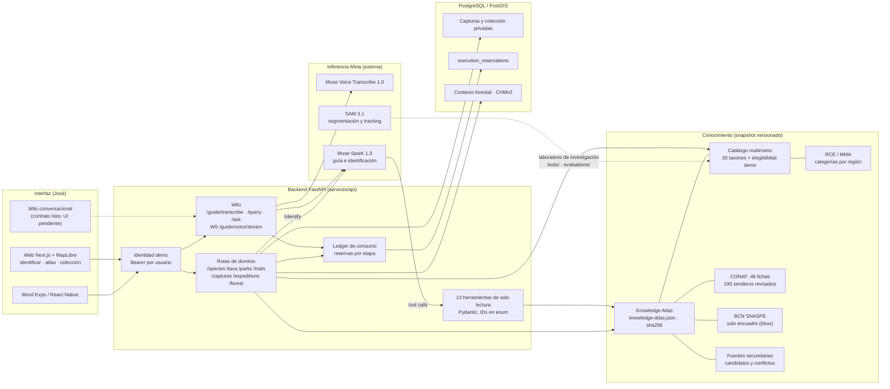
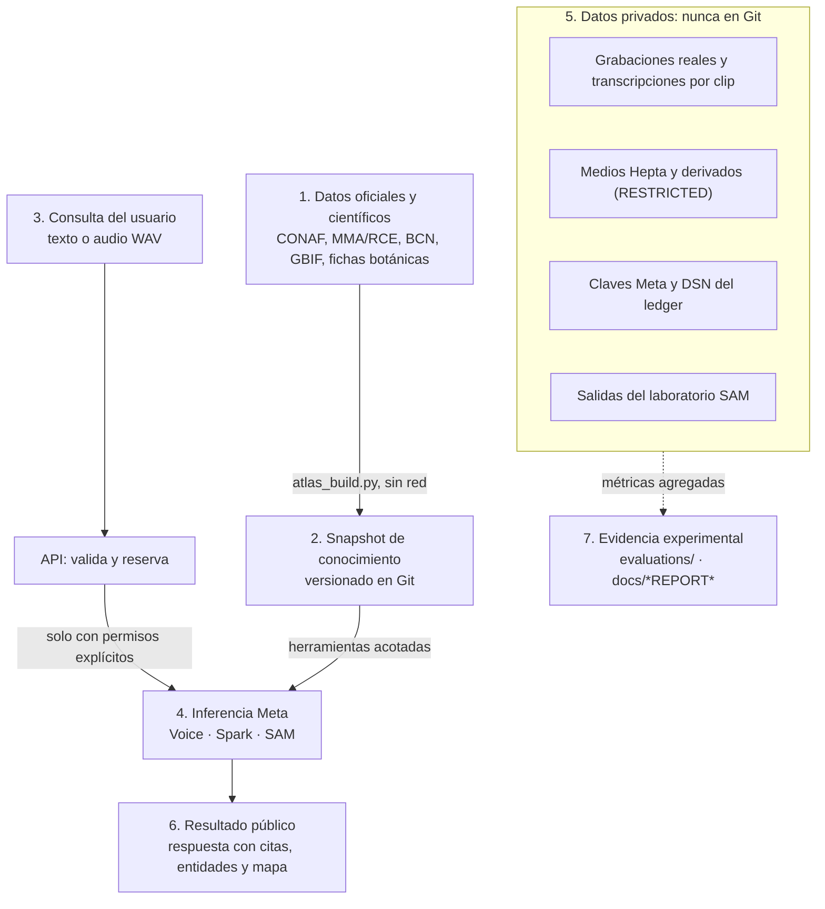

# Mapa de integración del proyecto

Este documento muestra cómo se conectan las piezas de Bosque Vivo en `main` al 04-11-2026. El estado de cada capacidad está en [PROJECT_DELIVERY_STATUS.md](PROJECT_DELIVERY_STATUS.md), y los contratos, en [FRONTEND_HANDOFF.md](FRONTEND_HANDOFF.md).

## Sistema

Líneas punteadas: integración que aún no está en la interfaz, o investigación fuera de la ruta productiva.

## Flujo de información y fronteras de privacidad

Reglas que el diagrama no debe ocultar:

- **El Atlas no entrena a Muse.** Es un snapshot que las herramientas consultan en cada pregunta; los pesos de ningún modelo cambian.
- **Un encuadre no es una ruta.** El `bbox` de BCN sirve para encuadrar el mapa. No hay geometría de senderos, y `geometry_available` es siempre `false`.
- **`not_verified` no significa abierto.** Ninguna fuente ofrece el estado de apertura en vivo.
- **SAM no identifica especies.** Segmenta y sigue objetos; la especie depende de la verificación y de las fuentes.
- **Las claves solo viven en el backend.** El WebSocket es un proxy y autentica ante Meta en su primer frame.

## Componentes y documentación

| Área | Código | Documentación canónica |
| --- | --- | --- |
| Web | `apps/web` | [apps/web/AGENTS.md](../apps/web/AGENTS.md), [DEMO_SCRIPT.md](DEMO_SCRIPT.md) |
| Móvil | `apps/mobile` | [apps/mobile/DESIGN.md](../apps/mobile/DESIGN.md) |
| API y contratos | `services/api` | [FRONTEND_HANDOFF.md](FRONTEND_HANDOFF.md), [api/openapi.json](api/openapi.json) |
| Wilo (voz y guía) | `services/api/src/bosque_api/wilo.py`, `services/botanical-ai/src/bosque_ai/{voice,guide}.py` | [WILO_VOICE_API_HANDOFF.md](WILO_VOICE_API_HANDOFF.md), [WILO_KNOWLEDGE_ARCHITECTURE.md](WILO_KNOWLEDGE_ARCHITECTURE.md) |
| Knowledge Atlas | `atlas.py`, `atlas_build.py`, `data/public/conaf/` | [WILO_PARKS_TRAILS_ATLAS.md](WILO_PARKS_TRAILS_ATLAS.md), [data/public/conaf/README.md](../data/public/conaf/README.md) |
| Biodiversidad | `biodiversity.py`, `demo.py`, `resources/taxa.json` | [WILO_BIODIVERSITY_DEMO_AUDIT.md](WILO_BIODIVERSITY_DEMO_AUDIT.md), [RCE_CONSERVATION_2026.md](RCE_CONSERVATION_2026.md) |
| Identificación | `services/botanical-ai`, `/identify` | [OPEN_SET_IDENTIFICATION_REPORT.md](OPEN_SET_IDENTIFICATION_REPORT.md), [MULTIKINGDOM_AI_EVALUATION.md](MULTIKINGDOM_AI_EVALUATION.md) |
| SAM 3.1 | `tools/meta_sam_api_lab`, `evaluations/sam_*` | [SAM31_EXTENDED_RESEARCH_REPORT.md](SAM31_EXTENDED_RESEARCH_REPORT.md) |
| GIS y bosque | `services/geospatial`, `/forest`, `/context` | [FOREST_CONTEXT_REPORT.md](FOREST_CONTEXT_REPORT.md), [GIS_ML_REPORT.md](GIS_ML_REPORT.md) |
| Ledger y costos | `execution.py`, `tools/meta_sam_api_lab/costs.py` | [ARCHITECTURE.md](ARCHITECTURE.md), [WILO_ASR_REAL_EVALUATION.md](WILO_ASR_REAL_EVALUATION.md) |
| Workers de investigación (PR #30, fuera de `main`) | rama `feat/meta-sam-dataset-workers` | Descripción del PR #30 |
| Gobernanza | — | [DATA_GOVERNANCE.md](DATA_GOVERNANCE.md), [DATASET_LICENSES.md](DATASET_LICENSES.md), [SECURITY.md](SECURITY.md) |
